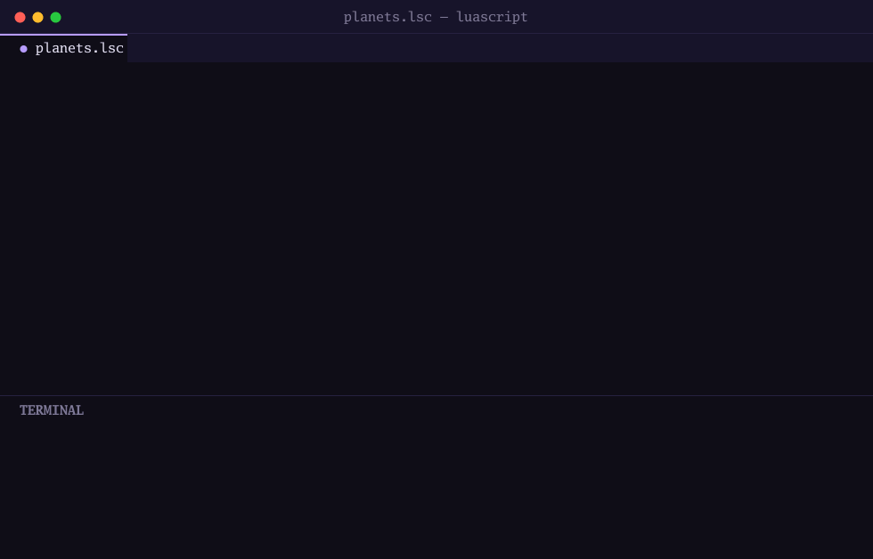

<p align="center">
  
</p>

<h1 align="center">LuaScript</h1>

<p align="center">
  Lua 5.4 with Luau-style gradual types, compiled to bytecode for a stack VM written in Go.
  <br>
  <a href="https://hilthontt.github.io/LuaScript/"><strong>Documentation</strong></a> ·
  <a href="https://hilthontt.github.io/LuaScript/docs/quick-start/">Quick start</a> ·
  <a href="examples/README.md">Examples</a> ·
  <a href="https://github.com/HilthonTT/LuaScript/releases">Releases</a>
</p>

<p align="center">
  <a href="https://github.com/HilthonTT/LuaScript/actions/workflows/ci.yml"></a>
  <a href="https://hilthontt.github.io/LuaScript/"></a>
  <a href="https://github.com/HilthonTT/LuaScript/actions/workflows/codeql.yml"></a>
  <a href="LICENSE"></a>
</p>

<p align="center">
  
</p>

The syntax tracks Lua 5.4: the same chunks, scoping rules, metatables,
coroutines and standard-library shape. Optional type annotations are checked at
compile time and erased before bytecode, so untyped Lua runs unchanged and typed
code costs nothing at run time.

## Install

```sh
go install github.com/hilthontt/luascript/v3/cmd/luascript@latest
```

Or download a prebuilt binary for Linux, macOS or Windows from
[Releases](https://github.com/HilthonTT/LuaScript/releases), or build from
source with `go build -o luascript ./cmd/luascript`. See
[Installation](https://hilthontt.github.io/LuaScript/docs/installation/).

## A taste

```lua
--!strict
type Planet = { name: string, moons: number, rings: string? }

enum Shape
    Circle(number),
    Rect(number, number),
end

local function area(s: Shape): number
    match s do
        Shape.Circle(r)  -> return math.pi * r * r
        Shape.Rect(w, h) -> return w * h
    end
    return 0
end

local p: Planet = { name = "Mars", moons = 2 }
print(`{p.name} has {p.moons} moons`)    -- Mars has 2 moons
print(area(Shape.Rect(3, 4)))             -- 12
print(p.rings ?? "no rings")              -- no rings
```

```sh
luascript planets.lsc     # run a script
luascript                 # start the REPL
```

## What you get

- **Lua 5.4 at heart**: metatables, coroutines, closures, `goto`, integer
  subtypes, `<const>`/`<close>` and the full pattern library.
- **Gradual types**: unions, optionals, literal types, generics with
  constraints, interfaces, intersections and narrowing. The standard library is
  typed, so `math.sqrt(true)` is a compile error.
- **Structs, tagged enums and `match`**, with exhaustiveness checking.
- **Modern syntax**: `?.`, `??`, `|>`, destructuring, spread, `continue`,
  if-expressions, default parameters and string interpolation.
- **Real error handling**: `try`/`catch`/`throw`, `defer`, and stack tracebacks
  across modules.
- **Batteries included**: json, an HTTP client and server, crypto, SQL
  databases, regexp, time, compression, collections, job queues and channels.
- **Data science**: N-d arrays, dataframes, stats, linear algebra, clustering,
  neural nets and SVG plots.
- **Tooling**: a formatter, a language server with a VS Code extension, a test
  runner, a static analyzer, a profiler, offline docs (`luascript doc`), and
  `luascript build` to bundle a script into a single executable.

All of it is covered in the
[documentation](https://hilthontt.github.io/LuaScript/docs/). For internals,
see [DESIGN.md](DESIGN.md) and the
[architecture guide](https://hilthontt.github.io/LuaScript/docs/architecture/).

## Contributing

See [CONTRIBUTING.md](CONTRIBUTING.md). Before sending a change, run
`make check` (gofmt, vet and the full test suite). Participation is governed by
the [Code of Conduct](CODE_OF_CONDUCT.md); report security problems through
[SECURITY.md](SECURITY.md), not a public issue.

Inspired by Lua 5.4 (syntax and semantics), Luau (the type system) and Goby
(the original stack VM scaffolding).

## License

MIT. See [LICENSE](LICENSE).
